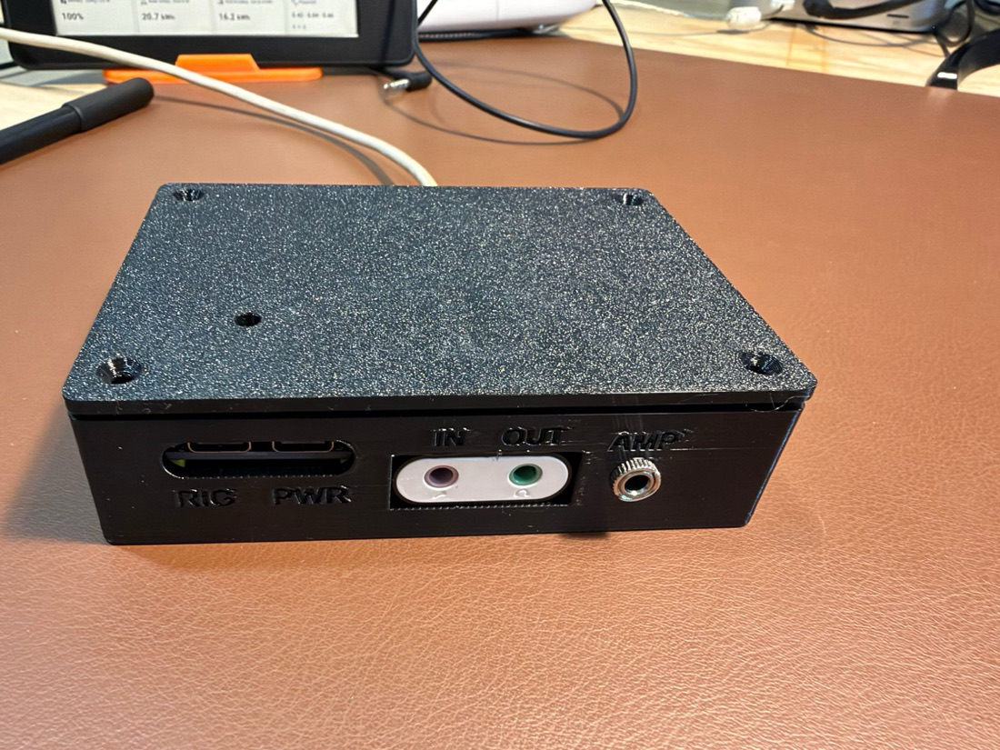

# RGO ONE SPE CAT Server

ESP32-S3 CAT bridge: polls the RGO ONE over USB host and feeds Kenwood-format
frequency to the SPE amp, so the amp follows band changes. Also serves Kenwood
CAT over TCP for Hamlib / WSJT-X and publishes rig state to MQTT.

**Status:** in service (2026-11-15), built into a 3D-printed box with a
CM108 USB audio dongle. Radio USB link, rig polling, Wi-Fi, TCP CAT, Hamlib,
WSJT-X (RX and TX audio), PTT, MQTT and the SPE amp following band changes
are all verified. **PTT is the radio's USB RTS line** (radio menu 33 ON,
menu 02 LINE IN ON; WSJT-X PTT Method = CAT): the box turns `TX;`/`RX;` into
RTS, because the RGO ONE's own CAT `TX;` only shows TX without
transmitting. Wiring: [`docs/wiring.svg`](docs/wiring.svg); full plan in
[`docs/BOX_PLAN.md`](docs/BOX_PLAN.md).



## How it works

```
RGO ONE ──USB (FT232R, 19200)──► ESP32-S3 ──UART1 TTL (Kenwood FA;/IF;)──► SPE amp
                                    │
                                    ├── TCP :4533 Kenwood CAT ──► Hamlib / WSJT-X
                                    └── MQTT shack/rgo-spe-cat/rig ──► Node-RED
```

The S3 is the only device on the radio's CAT port. It polls `IF;` every
150 ms. If the radio stops answering, it stops feeding the amp rather than hold
a stale band.

## Hardware

- ESP32-S3 N16R8 board. Native USB port → radio's USB-B (OTG port must supply
  5 V on VBUS). Flash and monitor via the board's COM port.
- SPE Expert 1.5K-FA CAT connector (DB15 male plug, 5 V TTL Kenwood):
  - GPIO17 → pin 10 (RX TTL)
  - pin 3 (TX TTL, 5 V) → 10 kΩ → GPIO18, with 20 kΩ from GPIO18 to GND
    (the S3 is not 5 V tolerant)
  - GND ↔ pin 4, and pin 11 (KEN TTL) → GND

  The amp polls `IF;` at 9600 baud with **inverted** polarity (the line
  idles low); the firmware inverts UART1 to match (`SPE_INVERT`).

## Quick start

```bash
python3 install.py     # bootstraps PlatformIO (macOS/Pi aware), verifies the build
./flash.sh             # build + upload (picks the serial port)
./ota.sh               # build + upload over Wi-Fi (call-back on TCP 48266)
./monitor.sh           # serial monitor
```

1. On first boot the node opens Wi-Fi AP **`vu2cpl-rgo-spe-cat-setup`**
   (password `vu2cpl1234`). Join it, pick your network, enter its password.
   Creds persist in NVS.
2. Copy `include/secrets.h.example` → `include/secrets.h` and set the MQTT
   broker address (`MQTT_HOST`), the MQTT role password (from the shack
   password manager), an OTA password, and the box's IP for `ota.sh`
   (`OTA_HOST`).
   `secrets.h` is git-ignored.
3. On the amp: SET → CAT → KENWOOD, baud 9600 (or set `SPE_BAUD` in
   `include/config.h` to match), then power-cycle the amp.

## PC software

Hamlib / WSJT-X: rig **Kenwood TS-480**, PTT via CAT. In WSJT-X put
`rgo-spe-cat.local:4533` (or the IP) in the **Serial Port** field — for a
Hamlib rig that field takes the network address. The RGO ONE doesn't answer `MD;`,
`FW;`, `PS;` or `AI;`, so the TCP server answers those itself.

## MQTT

- Broker: `MQTT_HOST` in `secrets.h`, port 1883 (auth required — `iot` role account in `secrets.h`;
  the broker ACL grants `iot` write on `shack/rgo-spe-cat/#`).
- `shack/rgo-spe-cat/status` — retained; LWT `{"event":"offline"}`, 30 s heartbeat.
- `shack/rgo-spe-cat/rig` — retained; `{"ok","freq_hz","band","mode","tx"}`.

## Layout

```
platformio.ini         env:rgo-spe-cat (ESP32-S3 N16R8, pioarduino)
include/config.h        pins, baud rates, timings, broker, topics (+ git-ignored secrets.h)
src/ftdi_host.*         USB host driver for the radio's FT232R
src/rig.*               radio task: owns the CAT port, rig state
src/spe.*               Kenwood emulation to the SPE
src/tcp_cat.*           Kenwood CAT over TCP
src/main.cpp            Wi-Fi, MQTT, OTA, status LED
tools/spe_test.py       bench-test the SPE CAT input from a Mac (sniff / emulate a TS-480)
flash.sh / monitor.sh   serial-port pickers (never pin the port)
ota.sh                  Wi-Fi upload through the UniFi IoT → Mac rule
install.py              toolchain bootstrap, macOS/Pi branch
enclosure/              3D-printed box (OpenSCAD); docs/BOX_PLAN.md has the plan + audio wiring
```

See `HANDOVER.md` for the full design, measured radio facts and open items.
