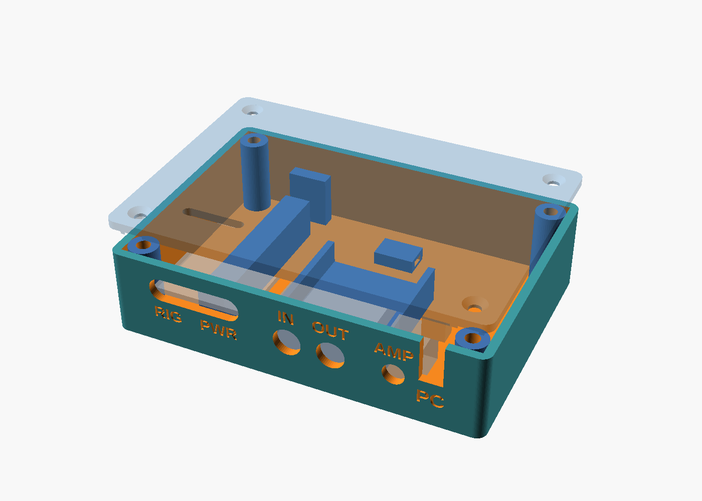

# Enclosure

3D-printed box for the S3 board and the CM108 audio dongle. Plan and
wiring: [`docs/BOX_PLAN.md`](../docs/BOX_PLAN.md).

**Status: draft 6 (2026-11-14), not printed.** Outer size 107 × 75 ×
27.8 mm. The base and lid render without errors and all layout checks pass.
The dongle is measured (28 × 29 × 11.3 mm body + 14 mm USB plug, jacks
12.4 mm apart, centres 6.35 mm up). Other sizes are datasheet values or guesses. They are marked `CHECK` in
`rgo_box.scad`; measure the parts and correct those values before printing.

## Panel

All connectors are on one panel, the back wall. Seen from outside, left to
right:

| Label | What | Cable |
|---|---|---|
| RIG | S3 native USB-C | → radio USB-B (CAT) |
| PWR | S3 COM USB-C | ← USB charger (USB-A → USB-C cable) |
| IN | CM108 mic jack (1/8") | ← radio RX audio |
| OUT | CM108 headphone jack (1/8") | → radio TX audio |
| AMP | 2.5 mm stereo (TRS) jack | → SPE amp (2.5 mm plug → DB15 male cable, 3 wires; pinout in `docs/BOX_PLAN.md`) |
| PC | Notch for the dongle's USB extension cable | → PC |

The radio audio cable has a DB15 male plug on ACC1, with the resistors
inside its hood, and two 1/8" plugs on the other end. It is not part of the
box. See `docs/BOX_PLAN.md`.

## Inside

- **S3 board:** its two USB-C sockets show through one slot. It sits on a
  rib between its header rows, held with foam tape. A stop block behind it
  keeps it from moving back when a cable is plugged in.
- **CM108 dongle:** lies in a cradle with its jack end against the panel. A
  zip tie through the cradle floor holds it. The USB extension socket sits
  behind it on a zip-tie anchor.
- **AMP jack:** a 2.5 mm stereo panel jack, a different size from the 1/8"
  audio jacks so the cables can't be swapped.
- **PC cable notch:** a tab on the lid closes it down to cable size, so the
  USB-A plug never has to go through a hole.
- **Lid:** 4 × M3 countersunk screws into heat-set inserts in the corner
  posts. A 3.2 × 18 mm slot sits over the status LED, just behind the USB-C
    sockets.

## Check before printing

| Parameter | Default | Measure |
|---|---|---|
| `notch_w` | 6.5 | PC cable diameter + 1 (cable not chosen yet; 6.5 suits a ~5.5 mm USB cable). Only the notch and the lid tab depend on it |
| `amp_jack_hole_d`, `amp_jack_body` | 6.2, 11 | The AMP jack's thread and body width |
| `insert_hole_d` | 4.0 | The bore your M3 heat-set inserts need |

## Use

1. Open `rgo_box.scad` in OpenSCAD and set the parameters in the Customizer.
2. `part = "assembly"` shows the box with ghost parts and prints the outer
   size. Asserts stop the render if parts collide.
3. Export each part as STL:
   - `part = "base"` prints upright;
   - `part = "lid"` is already flipped, lip up.

   No supports are needed. Use PETG or PLA with a 0.2 mm layer height.
4. Melt the 4 inserts into the posts. The lid screws are M3 × 8 flat-head.

Rendered STLs go in `stl/`, which git ignores.

## RF

The box is plastic and does not shield anything. If RF gets into the S3 or
the audio with the amp keyed, line the inside with copper tape connected to
ground. Put a ferrite clamp on every cable.
